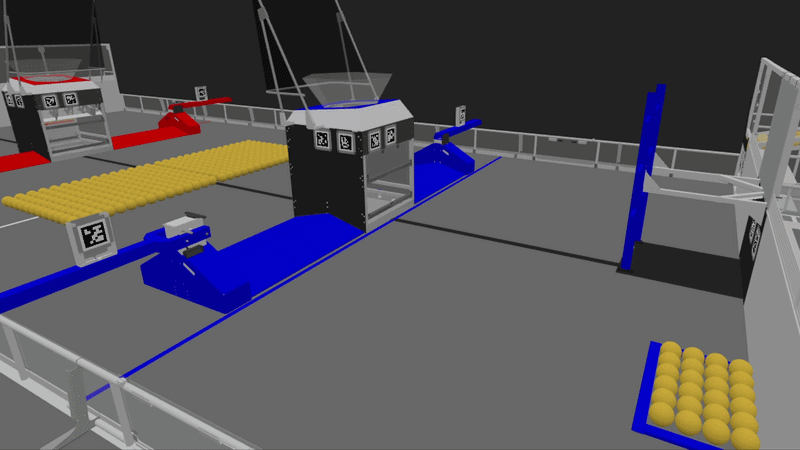

# Vortex



Vortex is a robot vision and localization project for FRC, built in Rust and
targeting Linux and the NVIDIA Jetson. It detects AprilTags, estimates camera poses
against a known field map, and uses camera mounting settings to calculate robot
position. Robot code can receive detection and localization data through
NetworkTables or UDP.

The project also includes a desktop simulator and image-based regression tests,
so the CPU vision pipeline can be developed without a robot or recorded camera logs.

## Features

- **AprilTag localization:** CPU detection, pose refinement, and multi-tag pose
  estimation using the configured field layout.
- **Camera configuration:** intrinsics, distortion coefficients, mounting offsets,
  and camera profiles in [config/config.json](config/config.json).
- **Robot telemetry:** NetworkTables and optional UDP output for camera detections,
  robot position, and processing statistics.
- **Optional Jetson acceleration:** NVIDIA VPI integration and TensorRT object
  detection, with an included ONNX-to-engine tool.
- **Interactive simulation:** keyboard driving, camera preview, actual and ghost
  chassis poses, and camera views in AdvantageScope.
- **Failure capture:** automatically save problematic camera frames and pose
  diagnostics as replayable cases, with cooldowns and deduplication.
- **Deployment interface:** an Electron app for editing configuration, deploying
  to a Jetson over SSH/SFTP, and monitoring the pipeline.

## Try it without a robot

From the repository root:

```text
python -m pip install -r chassis_sim/requirements.txt
python chassis_sim/drive.py --launch-advantagescope
```

Install AdvantageScope first. The simulator also needs Python with Tkinter and
a native Rust replay build. On Windows, that build uses the Rust GNU target and
MSYS2 MinGW64; a prebuilt replay can be supplied with `--replay-executable PATH`.
See the [simulator guide](chassis_sim/README.md) for setup and options.

In AdvantageScope, connect to **127.0.0.1 using NetworkTables 4**, add a **3D Field**,
select **2026 Field**, and use:

| Topic | Display |
| --- | --- |
| `/VortexSim/Actual` | Robot: the simulated chassis |
| `/VortexSim/Ghost` | Ghost: the estimate advanced using drive command history |
| `/VortexSim/RawVision` | Optional pose: the unmodified vision estimate |
| `/VortexSim/Camera` | Camera Override: the actual camera mount |

Click the Python camera preview to drive: **W/S** forward and backward, **A/D**
strafe, **Q/E** or **Left/Right arrows** rotate, and **Space** stops movement.

The camera defaults to **960 × 540** with a **40 FPS target**. The preview scales
with the window. Pose errors and saved failure cases use raw vision at image capture
time, independently of the displayed ghost's motion prediction.

## Testing

Generate camera images and replay them through the production CPU detector and
pose solver:

```text
python -m pip install -r simulation_tests/requirements.txt
python simulation_tests/run.py --suite smoke
python simulation_tests/run.py --suite extended
python simulation_tests/run.py --suite stress
```

The suites contain **7**, **256**, and **1,024** scenarios, covering tag viewpoints,
image noise, blur, brightness, and blank-image controls. See the
[testing guide](simulation_tests/README.md) for build requirements and reports.

Interactive failures are saved under `chassis_sim/generated/captures/`. Replay
them with:

```text
python chassis_sim/replay_captures.py chassis_sim/generated/captures
```

The simulator uses ideal pinhole images and a kinematic chassis. It models static
field occlusion, but does not model drivetrain physics, collisions, sensor noise,
motion blur, or lens distortion. Desktop replay exercises the CPU pipeline;
live camera capture and Jetson GPU performance require hardware validation.

## Project layout

| Directory | Purpose |
| --- | --- |
| [src/](src/) | Rust vision pipeline, pose estimation, and telemetry |
| [deployment/](deployment/README.md) | Native Rust deployment controller and regression tests |
| [config/](config/) | Runtime settings and field tag maps |
| [chassis_sim/](chassis_sim/) | Interactive simulator and captured-case replay |
| [simulation_tests/](simulation_tests/) | Synthetic image generation and native replay tests |
| [camera_calibration/](camera_calibration/) | Camera intrinsics and distortion calibration tools |
| [VortexDeploymentInterface/](VortexDeploymentInterface/README.md) | Jetson configuration and deployment app |
| [model_builder/](model_builder/README.md) | TensorRT engine builder |
| [docs/](docs/) | Documentation, README images, and demo videos |

The live application uses Linux V4L2 cameras. Deployment paths, camera indices,
and robot network settings are specific to your installation; review
[run_vortex.sh](run_vortex.sh) before using it on a Jetson.
